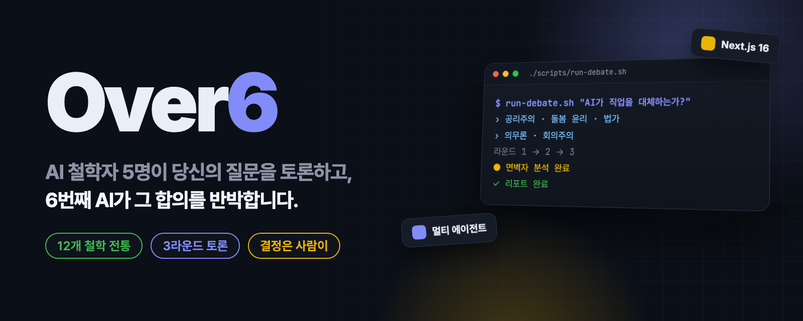
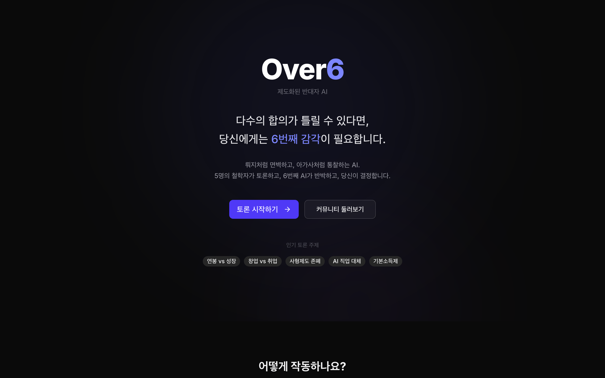
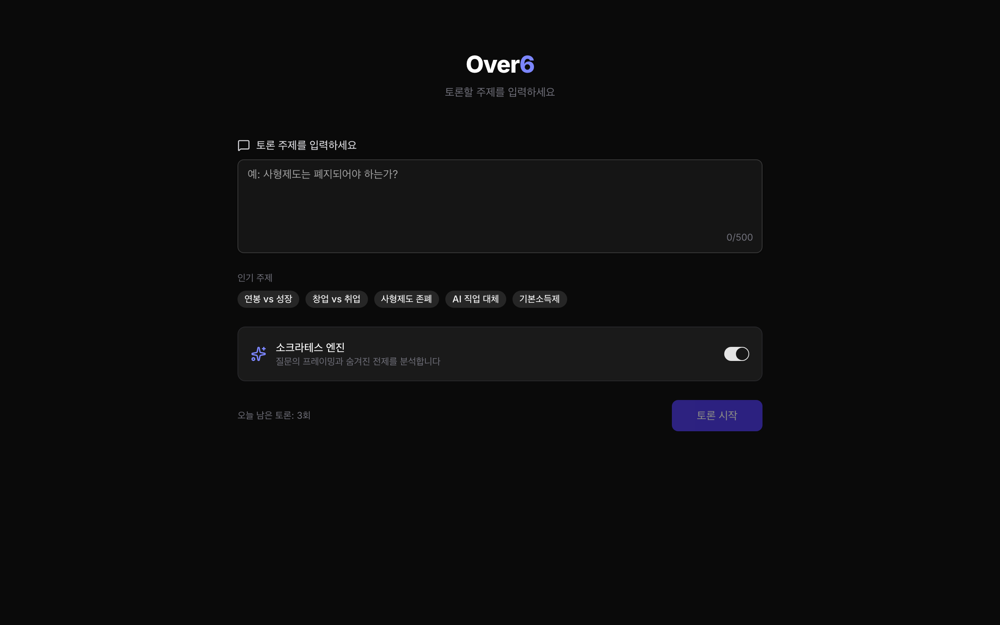
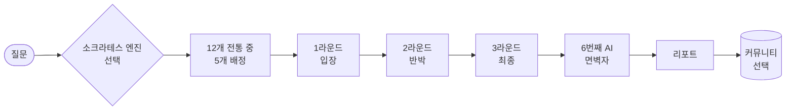

<p align="center">
  
</p>

<p align="center">
  <a href="README.md"><b>English</b></a> · <b>한국어</b>
</p>

<h2 align="center">모두가 동의할 때, 누군가는 반대해야 합니다.<br>Over6는 그 역할을 AI에게 맡깁니다.</h2>

<p align="center">
  멀티 에이전트 토론 앱입니다. 서로 다른 전통의 AI 철학자 5명이 당신의 질문을 3라운드 동안 토론하고,<br>
  6번째 AI가 그 합의를 해체합니다. 최종 판단은 당신이 합니다.
</p>

<p align="center">
  <a href="LICENSE"></a>
  <a href="https://github.com/kks0488/over6/stargazers"></a>
  
  <a href="https://github.com/kks0488/over6/commits/main"></a>
  
</p>

<table>
<tr>
<td width="50%" valign="top">

### 서로 부딪히도록 고른 철학자 5명
질문마다 12개 전통(공리주의, 의무론, 실존주의, 유교, 도가, 불교, 돌봄 윤리 등) 중 실제로 의견이 엇갈리는 5개를 골라 배정합니다.

</td>
<td width="50%" valign="top">

### 진짜 3라운드
1라운드 독립 입장, 2라운드 상호 반박, 3라운드 최종 입장. 철학자마다 자기 전통과 입장을 가진 별도의 AI 호출로 발언합니다.

</td>
</tr>
<tr>
<td width="50%" valign="top">

### 합의에 맞서는 6번째 AI
'면벽자'는 토론 참여자가 아닙니다. 증거 반박, 가설 역전, 편향·논리 해체, 근본 질문, 사멸 렌즈로 토론을 해체합니다.

</td>
<td width="50%" valign="top">

### 판결이 아니라 리포트
합의, 이견, 발견된 편향, 빠진 관점, 생각할 질문을 정리해 줍니다. 선택형 '소크라테스 엔진'이 토론 전에 질문의 프레이밍과 숨은 전제를 점검합니다.

</td>
</tr>
</table>

## 빠른 시작

Node.js 20 이상과 OpenAI 호환 API 키가 필요합니다.

```bash
git clone https://github.com/kks0488/over6.git
cd over6
npm install
cp .env.example .env.local   # OPENAI_API_KEY 입력 (프록시를 쓰면 OPENAI_BASE_URL도)
npm run dev                  # http://localhost:9032
```

토론 저장과 커뮤니티 페이지에는 Postgres(`POSTGRES_URL`, 예: Vercel Postgres·Neon)가 필요합니다.
없어도 토론은 돌아가고, 저장만 되지 않습니다.

## 데모

<p align="center"></p>

<p align="center"></p>

로컬 개발 서버에 대고 터미널에서 전체 과정을 돌릴 수도 있습니다.

<p align="center"></p>

화면의 철학자 배정은 실제 실행 결과이며, 전체 기록은
[`docs/debates/debate-ai-jobs.md`](docs/debates/debate-ai-jobs.md)에 있습니다(다른 예: [안락사](docs/debates/debate-euthanasia.md)).
앱 화면과 토론은 한국어입니다.

## 작동 방식



| 단계 | API 경로 | 파일 |
| --- | --- | --- |
| 질문 프레이밍·전제·편향 점검 | `POST /api/socrates` | `lib/ai/socrates.ts` |
| 의견이 엇갈리는 5개 전통 배정 | `POST /api/debate/assign` | `lib/ai/assigner.ts`, `lib/philosophers/` |
| 토론 라운드 | `POST /api/debate/round` | `lib/ai/debate.ts` |
| 6번째 AI 반박 | `POST /api/debate/sixth` | `lib/ai/sixth-ai.ts` |
| 사유 리포트 | `POST /api/debate/report` | `lib/ai/reporter.ts` |
| 저장·공유·삭제 | `/api/debates` | `lib/db/` |

서비스 설계 문서: [`Over6_ServiceDesign.md`](Over6_ServiceDesign.md).

## 자주 묻는 질문

**어떤 모델을 쓰나요?**
OpenAI 호환 Chat Completions API면 무엇이든 됩니다. `OPENAI_MODEL`(기본 `gpt-5.2`)과 `OPENAI_BASE_URL`로 정합니다.

**정답을 알려 주나요?**
아니요. 리포트는 입장별 강점·약점·열린 질문을 정리할 뿐이고, 결정은 일부러 사용자에게 남깁니다.

**실행하지 않고 토론 예시를 볼 수 있나요?**
네, [`docs/debates/`](docs/debates/)에 전체 기록 2개가 있습니다.

## 로드맵 (계획)

- 영어 화면과 영어 토론.
- 온라인 데모.

## 라이선스

[MIT](LICENSE) © 2026 Kyoungsoo Kim
