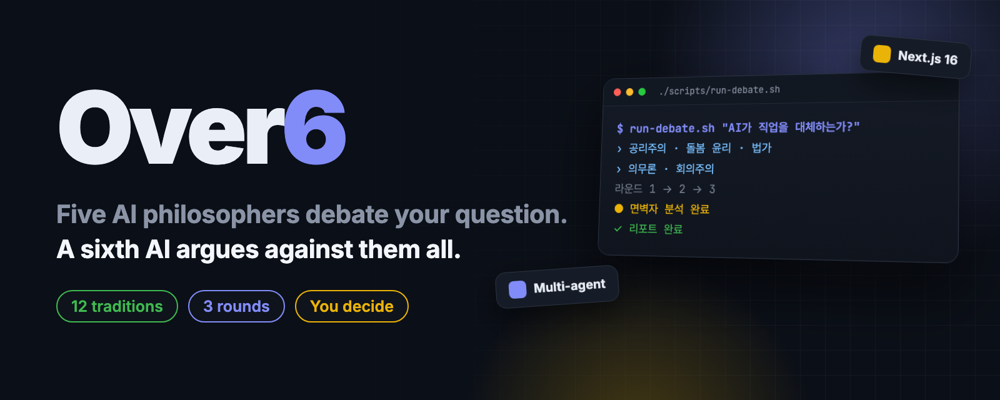
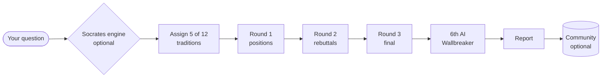

<p align="center">
  
</p>

<p align="center">
  <b>English</b> · <a href="README.ko.md"><b>한국어</b></a>
</p>

<h2 align="center">When everyone agrees, someone should argue back.<br>Over6 makes that someone an AI.</h2>

<p align="center">
  A multi-agent debate app: five AI philosophers from different traditions argue your question over three rounds,<br>
  then a sixth AI takes the consensus apart. The final call stays with you.
</p>

<p align="center">
  <a href="LICENSE"></a>
  <a href="https://github.com/kks0488/over6/stargazers"></a>
  
  <a href="https://github.com/kks0488/over6/commits/main"></a>
  
</p>

<table>
<tr>
<td width="50%" valign="top">

### Five philosophers, picked for disagreement
Your question is matched to 5 of 12 traditions (utilitarianism, Kantian ethics, existentialism, Confucianism, Daoism, Buddhism, care ethics and more), chosen so their views actually collide.

</td>
<td width="50%" valign="top">

### Three real rounds
Round 1: independent positions. Round 2: they rebut each other. Round 3: final positions. Every speaker is a separate prompt with its own tradition and stance.

</td>
</tr>
<tr>
<td width="50%" valign="top">

### A sixth AI against the consensus
The "Wallbreaker" is not a participant. It rebuts weak evidence, reverses hypotheses, exposes bias, asks the root question, and looks at it through mortality.

</td>
<td width="50%" valign="top">

### A report, not a verdict
You get consensus, dissent, biases found, missing perspectives and questions to think about. An optional "Socrates engine" checks your question's framing before the debate starts.

</td>
</tr>
</table>

## Quick start

Requires Node.js 20+ and an API key for any OpenAI-compatible endpoint.

```bash
git clone https://github.com/kks0488/over6.git
cd over6
npm install
cp .env.example .env.local   # add OPENAI_API_KEY (and OPENAI_BASE_URL if you use a proxy)
npm run dev                  # http://localhost:9032
```

Saving debates and the community page need a Postgres database (`POSTGRES_URL`, e.g. Vercel Postgres or Neon).
Without it, debates still run; they just aren't stored.

## Demo

<p align="center"></p>

<p align="center"></p>

The whole pipeline can also run from the terminal against a local dev server:

<p align="center"></p>

The philosophers shown are the ones assigned in a real run; the full transcript is in
[`docs/debates/debate-ai-jobs.md`](docs/debates/debate-ai-jobs.md) (another one: [euthanasia](docs/debates/debate-euthanasia.md)).
The app's interface and debates are in Korean.

## How it works



| Step | API route | File |
| --- | --- | --- |
| Question framing, assumptions, bias check | `POST /api/socrates` | `lib/ai/socrates.ts` |
| Pick five traditions that disagree | `POST /api/debate/assign` | `lib/ai/assigner.ts`, `lib/philosophers/` |
| Debate rounds | `POST /api/debate/round` | `lib/ai/debate.ts` |
| Sixth AI rebuttal | `POST /api/debate/sixth` | `lib/ai/sixth-ai.ts` |
| Thinking report | `POST /api/debate/report` | `lib/ai/reporter.ts` |
| Save, share, delete | `/api/debates` | `lib/db/` |

The product design (in Korean) is in [`Over6_ServiceDesign.md`](Over6_ServiceDesign.md).

## FAQ

**Which models does it use?**
Anything behind an OpenAI-compatible Chat Completions API. Set `OPENAI_MODEL` (default `gpt-5.2`) and `OPENAI_BASE_URL`.

**Is it an answer engine?**
No. The report lays out positions, strengths, weaknesses and open questions. Deciding is left to you on purpose.

**Can I read past debates without running anything?**
Yes, two full transcripts are in [`docs/debates/`](docs/debates/).

## Roadmap (planned)

- English interface and English-language debates.
- Hosted demo.

## License

[MIT](LICENSE) © 2026 Kyoungsoo Kim
